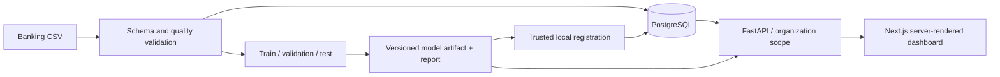

# Customer Churn Intelligence Platform

Production-oriented, multi-industry customer churn prediction and retention intelligence platform powered by machine learning, FastAPI, Next.js, PostgreSQL, and MLOps.

This repository currently delivers a **banking vertical slice**. The shared application stores dataset lineage, model versions, customer records, predictions, and analytics. A `ChurnDefinition` specifies what a positive outcome means for each integration. Retail, telecommunications, insurance, SaaS, and hospitality require their own definitions, validation contracts, feature pipelines, and evaluated models; they are planned integrations, not implemented claims.

## What works now

- A versioned banking CSV contract (`banking-csv-contract/1.0.0`) with a full data-quality report, SHA-256 dataset fingerprint, and no silent row drops or imputation. See [the contract](docs/banking-data-contract.md).
- Reproducible exploratory-analysis artifacts, each labeled SYNTHETIC or EXTERNAL.
- Dataset lineage: a training report and model registration are tied to the exact dataset hash, contract version, source kind, and quality report, and the model artifact hash is verified before it is loaded.
- Retrospective banking `Exited` classification with deterministic train / calibration / held-out test partitions recorded per customer and per training run. A dummy baseline, logistic regression, and gradient-boosted trees are compared by cross-validation on the training partition only; probabilities are calibrated and the decision threshold chosen on the calibration partition; the test partition is evaluated once. See [the ML methodology](docs/banking-ml-methodology.md).
- Held-out ROC-AUC, PR-AUC, precision, recall, F1, confusion matrix, Brier score, reliability table, recall at a documented review capacity, bootstrap 95% intervals, subgroup slices with explicit "insufficient data" states, and sensitivity analyses without demographic attributes and without features of uncertain pre-exit availability.
- Explicit schema migrations (`python -m churn.cli migrate`) that back up SQLite first and mark pre-existing rows without recorded lineage as unverified.
- Versioned scikit-learn pipeline artifacts and a measured test report.
- PostgreSQL-backed customer, dataset, model, and prediction records through SQLAlchemy. SQLite works for local tests.
- API-key protected, organization-scoped customer, model, prediction, and analytics endpoints.
- Retrospective scoring of imported customers (batch and on-demand) with the same artifact. Scores are stored apart from evaluation predictions and labelled by score type and by the customer's partition (training and calibration customers are in-sample).
- Next.js dashboard with overview, customer list/detail, risk segmentation by partition, full model evaluation, data lineage, and definition pages. Empty and unverified states are shown as such; no in-sample score is presented as performance.
- Docker Compose for local PostgreSQL, API, and web services; Python and frontend checks in CI.

## Banking dataset and honest limits

The initial adapter expects the widely used **Bank Customer Churn / Churn Modelling** CSV with columns `CustomerId`, `CreditScore`, `Geography`, `Gender`, `Age`, `Tenure`, `Balance`, `NumOfProducts`, `HasCrCard`, `IsActiveMember`, `EstimatedSalary`, and `Exited`. [Kaggle's Churn Modelling data page](https://www.kaggle.com/competitions/churn-modelling/data) describes `Exited` as a binary exit target. Download a copy whose terms permit your use and place it in `data/raw/`; no third-party banking data is committed here.

The source is a cross-sectional sample. It does **not** provide observation timestamps, a feature availability cutoff, an explicit future horizon, or intervention outcomes. The initial model is therefore a **snapshot classification exercise**, not a validated future forecast. The dashboard does not show a historical churn trend, revenue loss, retention effect, or causal explanation because those cannot be derived from this data. A prospective banking deployment needs time-stamped observations, a precise account closure definition, a horizon, eligibility rules, and temporal evaluation.

The repository also includes an **explicitly synthetic** generator for a local walkthrough. Always pass `--source-kind synthetic` for it; the source kind is required for training, import, and EDA, and the dashboard labels it. See [provenance and permitted use](docs/banking-dataset-provenance.md) and the [leakage review](docs/banking-leakage-review.md). Its scores measure behavior on generated data only and must not be cited as banking performance.

## Architecture



The browser never receives the API key. Next.js server components use a server-side key to call FastAPI. The dashboard requires HTTP Basic credentials, and the API key grants access to one configured organization. This is a **local demonstration security boundary**, not multi-user enterprise authentication. Use HTTPS and managed identity before internet deployment. See [architecture notes](docs/architecture.md) for the schema and upgrade path.

## Quick start with synthetic data

Requires Python 3.12–3.14, Node 22+, and PostgreSQL 16 or Docker. For a quick local run, SQLite can replace PostgreSQL.

```bash
python3 -m venv .venv
source .venv/bin/activate
pip install -e '.[dev]'
cp .env.example .env
# Edit API_KEY to a long random value. For local SQLite only:
export DATABASE_URL=sqlite:///./churn.db
export API_KEY=your-local-random-secret
python -m churn.cli init-db
python scripts/make_demo_data.py
python -m churn.ml.data data/raw/banking-demo-synthetic.csv --source-kind synthetic
python -m churn.ml.eda data/raw/banking-demo-synthetic.csv --source-kind synthetic
python -m churn.ml.train data/raw/banking-demo-synthetic.csv --source-kind synthetic   # ~15 s; prints the full evaluation report
python -m churn.cli import data/raw/banking-demo-synthetic.csv --source-kind synthetic
python -m churn.cli register artifacts/banking-account-exit-v1-<dataset-hash-prefix>.json
python -m churn.cli score-all
uvicorn churn.api:app --reload
```

Use the exact report path printed by training for the `register` command. In a second shell:

```bash
cd apps/web
npm install
API_KEY=your-local-random-secret DASHBOARD_USERNAME=analyst DASHBOARD_PASSWORD=your-separate-dashboard-password npm run dev
```

Open `http://localhost:3000` and enter the dashboard credentials. The same CSV and the same `--source-kind` must be used for validation, training, and import; registration refuses a report whose dataset hash, source kind, contract version, or quality report differs from the imported dataset. `RowNumber` and `Surname`, if present, are ignored and never stored. To use an approved real CSV, follow [the exact steps](docs/banking-dataset-provenance.md#importing-an-approved-real-csv).

**Upgrading an existing local database:** do not delete it. Run `python -m churn.cli migrate --check` to see pending migrations (exit code 1 if any), then `python -m churn.cli migrate`. For SQLite this first writes `<file>.pre-migration-v<N>-<UTC time>.bak` next to the database (Postgres: take your own backup first). Migrations only add columns and tables. Rows from before lineage was recorded keep `NULL` lineage and appear as **unverified** in the API and dashboard: their models cannot be used for new scoring, their customers have no recorded split ("No split recorded"), and no held-out metrics are shown for them. The API refuses to start on an out-of-date schema and `init-db` refuses to touch one. To get verified results, retrain, import the same CSV into a new organization (or a fresh database), register, and score.

For Docker Compose, create `.env` with a real `API_KEY` and separate dashboard credentials, then run `docker compose up --build`. This starts an empty PostgreSQL database and dashboard. `./artifacts` and `./data/raw` are mounted in the API container. Complete training, import, and scoring with:

```bash
docker compose exec api python -m churn.ml.train data/raw/banking-demo-synthetic.csv --source-kind synthetic
docker compose exec api python -m churn.cli import data/raw/banking-demo-synthetic.csv --source-kind synthetic
docker compose exec api python -m churn.cli register artifacts/<exact-report-filename>.json
docker compose exec api python -m churn.cli score-all
```

The Python local workflow above is the simplest complete walkthrough.

## Data quality and exploratory analysis

```bash
python -m churn.ml.data data/raw/banking-demo-synthetic.csv --source-kind synthetic --output reports/quality.json   # exit 1 if the file fails
python -m churn.ml.eda  data/raw/banking-demo-synthetic.csv --source-kind synthetic                                  # -> reports/eda-synthetic-<hash>/
```

Observable outputs of the EDA command, all in `reports/eda-<source_kind>-<first 12 hash chars>/` (gitignored): `README.md` (label banner, caveats), `manifest.json` (file hashes), `quality_report.json`, `class_balance.csv`, `missing_values.csv`, `numeric_summary.csv`, `numeric_histograms.csv`, `categorical_distribution.csv`, `segment_exit_rates.csv` (with Wilson 95% intervals and a small-segment flag), `target_correlations.csv`, `feature_correlations_spearman.csv`, `outlier_summary_iqr.csv`, and `outlier_rows.csv` (by data-row number, not customer ID). The output is byte-identical for identical input. Only files that pass the contract are profiled; a failing file prints its issue list and writes nothing.

The dashboard's Data page shows each dataset's source kind, contract version, and quality status; the Models page shows each model's data source. `GET /api/v1/datasets` and `/api/v1/models` also return the quality-issue summary and lineage.

## Model evaluation outputs

Training writes four files per run to `artifacts/` (gitignored), all named `<definition>-<dataset hash>-<config hash>`: `.json` (the report), `.joblib` (the scoring artifact), `.splits.csv` (every customer's partition), and `.evaluation.csv` (out-of-sample probabilities for calibration and test customers). The report records their SHA-256 hashes, and `register` verifies all of them, checks the splits against the imported customers, and stores `split_assignments`, `evaluation_predictions` (kept apart from `predictions`), and the evaluation in the database. Training options: `--seed`, `--review-capacity` (default 0.10, an illustrative share of customers a team could review), `--bootstrap-resamples`.

API additions: `GET /api/v1/models/{id}/evaluation`; `GET /api/v1/analytics/risk-distribution?partition=test|calibration|train|unknown|all` (default `test`); every customer prediction carries `partition`, `in_sample`, and `score_kind`; `/analytics/overview` reports scores per partition and has no pooled mean score; `/analytics/segments` averages scores over held-out customers only.

Synthetic-data results (600 rows, 16 test exits) have wide intervals and most subgroup slices are reported as insufficient data. Treat them as a demonstration that the machinery is honest, not as banking performance.

## API examples

```bash
curl -H "X-API-Key: $API_KEY" http://localhost:8000/api/v1/analytics/overview
curl -H "X-API-Key: $API_KEY" http://localhost:8000/api/v1/customers
curl -X POST -H "X-API-Key: $API_KEY" -H 'Content-Type: application/json' \
  -d '{"customer_id":"<internal customer UUID>"}' http://localhost:8000/api/v1/predictions
```

OpenAPI documentation is at `http://localhost:8000/docs`. `GET /health/live` and `/health/ready` support operational checks.

## Verification

```bash
.venv/bin/ruff check churn scripts tests
.venv/bin/pytest -q
cd apps/web && npm run lint && npm run build
```

Tests cover the contract (bad files, boundary values, duplicate IDs, missing values), EDA reproducibility and labeling, lineage mismatches, split isolation and reproducibility, calibration and threshold isolation from test data, metric calculations, artifact loading, migrations from the real earlier schemas, and the partition-aware analytics. The integration test generates synthetic data, trains, imports, registers, scores, checks API authorization, and checks dashboard aggregation contracts. Test metrics vary with the generated sample and are not advertised as real-world results.

## Security and operational limits

Use only public or approved data. Raw CSVs, artifacts, local databases, and `.env` are gitignored. Model loading uses `joblib` and is restricted to trusted local administrator registration because deserializing untrusted artifacts is unsafe. This slice does not expose unrestricted uploads. The API key should be replaced with per-user authentication, role-based authorization, audit logging, rate limits, and a migration-managed database before external deployment. Avoid using snapshot scores for lending, access, or other consequential decisions.

## Roadmap

1. **Banking data contract and vertical slice — implemented:** validated CSV, baseline comparison, artifact, persisted scores, API, and live dashboard. Completion gate: integration test and frontend build.
2. **Banking data engineering — implemented (this phase):** versioned contract, quality report, EDA artifacts, leakage review, and lineage. Gate: tests below.
3. **Retrospective ML evaluation — implemented (this phase):** recorded splits, model comparison on training data only, calibration, held-out metrics with intervals, subgroup and sensitivity analyses, safe migrations, and partition-aware dashboard. Gate: tests below.
4. **Prospective banking data — next:** see "Requirements for genuinely prospective prediction" in [the ML methodology](docs/banking-ml-methodology.md).
5. **Operational hardening:** Alembic migrations, identity/RBAC, audit logs, job queue, model promotion/rollback, monitoring, and deployment documentation. Gate: security and recovery exercises.
6. **Retail integration:** purchase-cycle-based inactivity with an evidence-based window, retail features, and separate model. Gate: independent temporal evaluation.
7. **Telecommunications integration:** service termination definition, telecom feature pipeline, and separate model. Gate: independent evaluation and calibrated scoring.

Repository name suggestion: `customer-churn-intelligence`. No deployment, GitHub commit, or PR is performed by this project setup.
