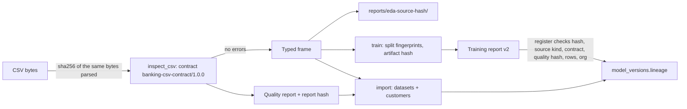

# Architecture and design decisions

## Boundary

The platform owns reusable ingestion contracts, persistence, serving, and dashboard infrastructure. Each domain owns a `ChurnDefinition`, source adapter, eligibility, labels, features, evaluation design, and model. Banking `Exited` is defined at **customer** level. Account, policy, and contract churn must have separate entities and identifiers.

## Initial relational schema

| Table | Key relationships | Purpose |
| --- | --- | --- |
| `organizations` | primary key `id` | Workspace boundary |
| `datasets` | `organization_id → organizations.id`, unique `(organization_id, sha256)` | Source version: definition key, `source_kind`, `contract_version`, `quality_status`, full `quality_report` JSON and its hash |
| `customers` | `organization_id → organizations.id`, `dataset_id → datasets.id`, unique `(organization_id, external_id)` | Validated source attributes and observed exit |
| `model_versions` | `dataset_id → datasets.id` | Versioned artifact and its SHA-256, dataset/split `lineage` copied from the training report, test metrics, lifecycle status |
| `predictions` | `customer_id → customers.id`, `model_id → model_versions.id` | Probability, risk band, and UTC scoring timestamp |

Every customer read is filtered by organization. Model registration is a trusted local operation and ties a model to an imported dataset hash. A production extension should add memberships, roles, audit logs, training runs, intervention/outcome records, batch jobs, and schema migrations when their workflows exist.

## Data engineering and lineage

Rules the code enforces: the file is hashed and parsed from one read; a failing file yields a report and imports nothing; `source_kind` is explicit at every entry point and one hash cannot be stored under two kinds; registration is scoped to the organization and rejects any mismatch between the training report and the imported dataset; the artifact (a pickle) is re-hashed before every load. See the [contract](banking-data-contract.md), [provenance](banking-dataset-provenance.md), and [leakage review](banking-leakage-review.md).

Known scale limits: CSVs are read into memory (capped at 50 MiB); customers are bulk-inserted in one transaction; analytics endpoints still aggregate in Python. Replace these with chunked loading and SQL aggregation before multi-million-row use.

## ML methodology

`CustomerId`, `Surname`, and `RowNumber` are excluded from features. Preprocessing is inside the fitted pipeline. Data are split 60% train, 20% validation, and 20% held-out test with fixed stratification. A dummy prior baseline and class-weighted logistic regression are compared on validation PR-AUC; the selected pipeline is measured once on test. The reported Brier score provides a first calibration diagnostic, but no calibration claim is made. The source has one row per customer, so a temporal evaluation is impossible. If multiple dated observations are added, use grouped temporal splits with a feature cutoff before the label window.

Risk bands 0.30/0.60/0.80 are illustrative configuration. They do not represent validated campaign capacities or expected intervention benefit.

## Future monitoring

Add versioned input distribution summaries and compare them with scored traffic. Compute realized performance only after outcome windows mature. Data drift should trigger investigation, not automatic model replacement. Promotion should require explicit validation gates and rollback support.
